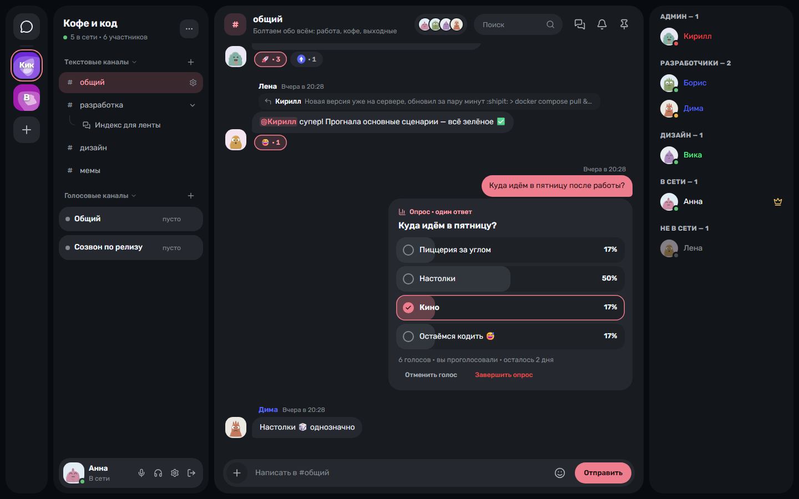
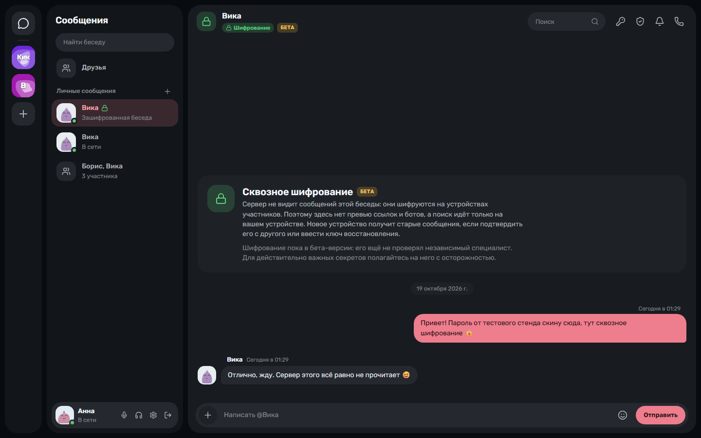
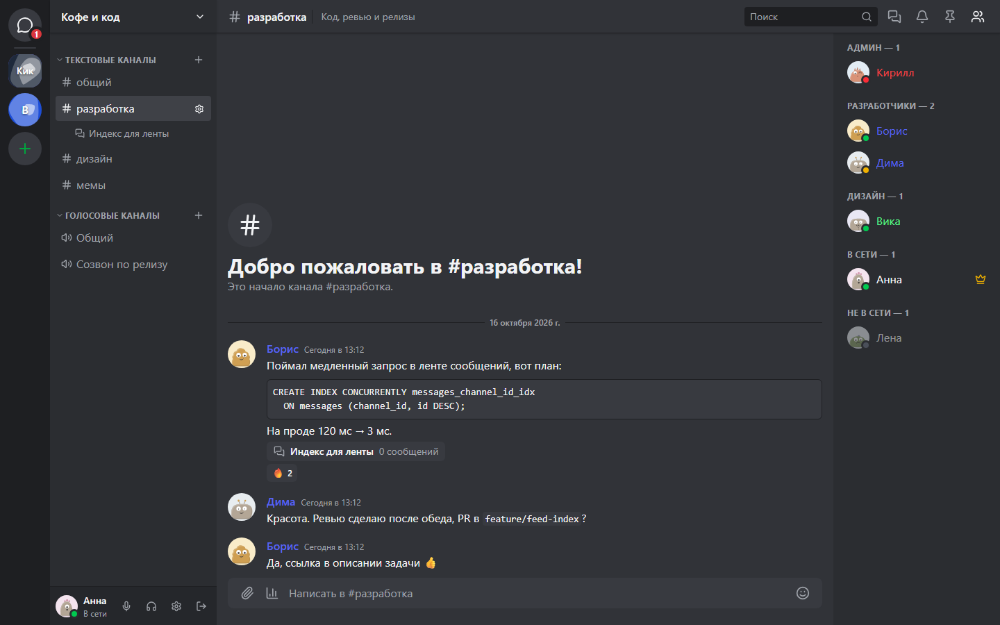
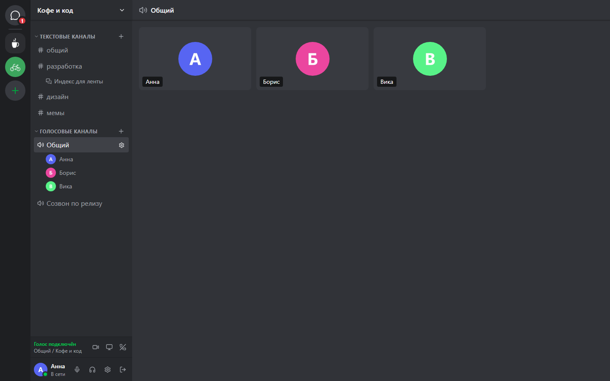
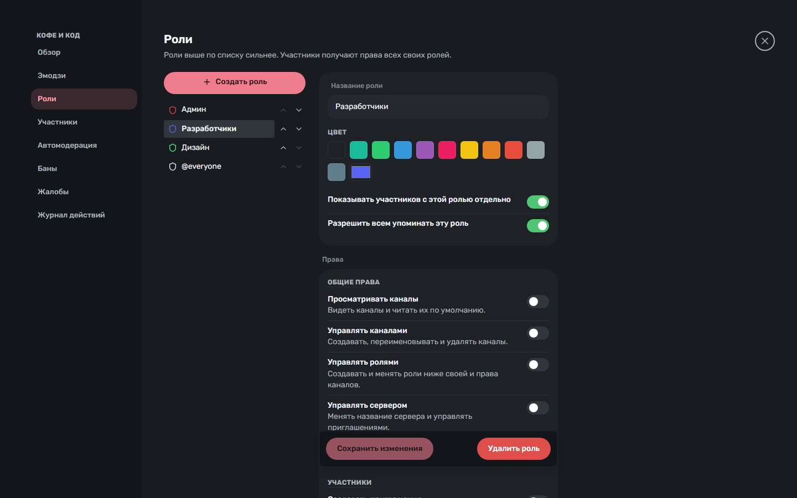
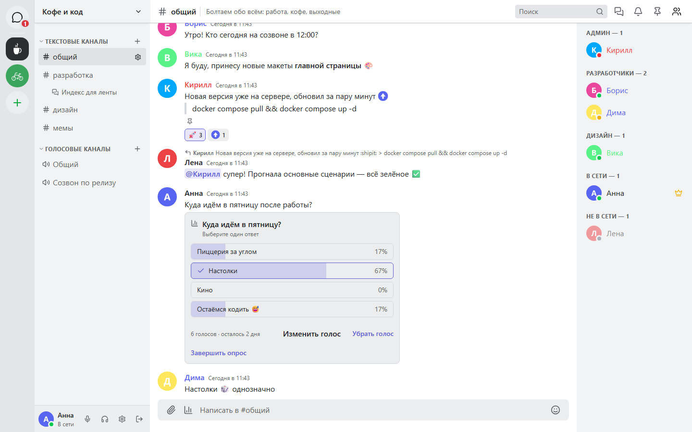

<div align="center">


# Chinchi Chat

**Свой Discord на своём сервере.** Серверы и каналы, личные сообщения, голос и видео,
сквозное шифрование. Бесплатно и с открытым кодом.

[](https://github.com/vogster/ChinchiChat/releases/latest)
[](https://github.com/vogster/ChinchiChat/actions/workflows/ci.yml)
[](LICENSE)

[Установка](#установка) · [Возможности](#возможности) · [Скриншоты](#скриншоты) · [Руководство (wiki)](https://github.com/vogster/ChinchiChat/wiki) · [Шифрование](docs/encryption.md) · [Разработка](#разработка)



</div>

> [!NOTE]
> Версия до 1.0. Всё работает, но API и формат данных ещё могут меняться между версиями.
> Сквозное шифрование помечено как **бета**: независимой проверки ещё не было.

## Зачем

- **Данные у вас.** Переписка, файлы и голос не уходят третьим сторонам. Сервер ставится одной командой через Docker.
- **Привычно.** Устроено как Discord: серверы, каналы, роли, треды, голосовые комнаты. Переучиваться не придётся.
- **Приватно, когда нужно.** Личные сообщения и группы можно сделать зашифрованными: их не прочитает даже администратор сервера.

## Возможности

**💬 Общение**

- Серверы с текстовыми и голосовыми каналами, категориями, каналами объявлений и тредами
- Сообщения в реальном времени: ответы, реакции, markdown, упоминания, закрепы, вложения, превью ссылок
- Опросы, пересылка сообщений, поиск, свои эмодзи сервера (в том числе анимированные)
- Друзья, личные сообщения и группы до 10 человек

**🎙️ Голос и видео**

- Голосовые каналы, камера и демонстрация экрана на базе [LiveKit](https://livekit.io)
- Звонки в личных сообщениях и группах
- Модерация голоса: выключить микрофон или звук, перенести в другой канал, отключить

**🔒 Приватность и безопасность**

- Зашифрованные беседы (MLS): сообщения, файлы, реакции и звонки шифруются на устройствах участников ([как это устроено](docs/encryption.md))
- Ключ восстановления и подтверждение нового устройства со старого по четырём эмодзи
- Двухфакторная аутентификация, шифрование файлов на диске сервера, экспорт своих данных

**🛡️ Управление сообществом**

- Роли с гибкими правами на сервер и отдельные каналы
- Баны, тайм-ауты, жалобы, автомодерация, журнал действий
- Боты, слэш-команды и вебхуки

**📦 Свой сервер**

- Готовые образы, развёртывание через `docker compose`
- Регистрация открытая, по приглашениям или закрытая; админ-панель инстанса
- В планах: приложения для компьютера (Tauri) и телефона (iOS/Android)

## Скриншоты

<table>
  <tr>
    <td width="50%"><br><sub>Зашифрованная беседа: сервер видит только шифротекст</sub></td>
    <td width="50%"><br><sub>Блоки кода, треды и реакции</sub></td>
  </tr>
  <tr>
    <td width="50%"><br><sub>Голосовой канал</sub></td>
    <td width="50%"><br><sub>Роли и права</sub></td>
  </tr>
  <tr>
    <td colspan="2"><br><sub>Светлая тема</sub></td>
  </tr>
</table>

## Установка

Нужен сервер с Docker и три DNS-имени: для чата, голоса и файлов.

```bash
mkdir chinchi && cd chinchi
curl -fsSLO https://github.com/vogster/ChinchiChat/releases/latest/download/docker-compose.yml
curl -fsSL -o .env https://github.com/vogster/ChinchiChat/releases/latest/download/env.example
# заполните .env: домены и секреты
docker compose up -d
```

Администратором станет учётная запись, зарегистрированная с адресом из `INITIAL_ADMIN_EMAIL` (обязательная переменная).

Подробно — в [руководстве по установке](docs/self-hosting.md): требования, порты, обновление, резервные копии, голос за NAT, сборка из исходников.

**Обновление** — поменяйте `CHINCHI_VERSION` в `.env` (или скачайте новый `docker-compose.yml`) и выполните `docker compose pull && docker compose up -d`. Миграции применяются сами. Что нового — в [релизах](https://github.com/vogster/ChinchiChat/releases).

## Разработка

Нужны Node.js 24+, pnpm 11 и Docker (на macOS удобно через [OrbStack](https://orbstack.dev)).

```bash
pnpm install
pnpm dev:up          # Postgres, Valkey, RustFS (S3), LiveKit, Mailpit
cp apps/server/.env.example apps/server/.env
pnpm dev             # сервер на :3000, web на http://localhost:5173
```

| Сервис          | Адрес                                 |
| --------------- | ------------------------------------- |
| Web             | http://localhost:5173                 |
| API             | http://localhost:3000/health          |
| Mailpit (почта) | http://localhost:8025                 |
| RustFS консоль  | http://localhost:9001/rustfs/console/ |
| LiveKit         | ws://localhost:7880                   |

Проверки перед коммитом: `pnpm format && pnpm lint && pnpm typecheck && pnpm test` (интеграционным тестам нужен Docker). E2E: `pnpm e2e`.

Демо-данные для скриншотов: `node scripts/demo-data.mjs` заполнит dev-стек живым сервером, `node scripts/demo-screenshots.mjs <суффикс>` снимет скриншоты в `docs/screenshots`.

<details>
<summary>Стек и структура</summary>

- `apps/server` — Fastify, zod, Drizzle, Postgres, Valkey; голос — LiveKit, файлы — S3 (RustFS)
- `apps/web` — React 19, Vite, Tailwind 4, TanStack Router и Query
- `packages/sdk` — REST-клиент, общий для всех клиентов
- `packages/shared` — zod-схемы и типы для сервера и клиентов
- `packages/markdown` — разбор markdown сообщений
- `packages/e2ee` — сквозное шифрование (MLS на ts-mls)
- `e2e` — Playwright-тесты по production-сборке

Архитектура и решения — в [PLAN.md](PLAN.md), прогресс — в [TODO.md](TODO.md), правила для участников и агентов — в [AGENTS.md](AGENTS.md).

</details>

## Документы

- [Руководство пользователя и администратора](https://github.com/vogster/ChinchiChat/wiki) — wiki со всеми возможностями
- [Установка на свой сервер](docs/self-hosting.md)
- [Шифрование](docs/encryption.md): что защищено, от кого и как это устроено
- [Чек-лист безопасности](docs/security-checklist.md)
- [Релизы](https://github.com/vogster/ChinchiChat/releases)

Нашли уязвимость? Сообщите приватно: **Security → Report a vulnerability** на GitHub.

## Лицензия

[AGPL-3.0](LICENSE)
